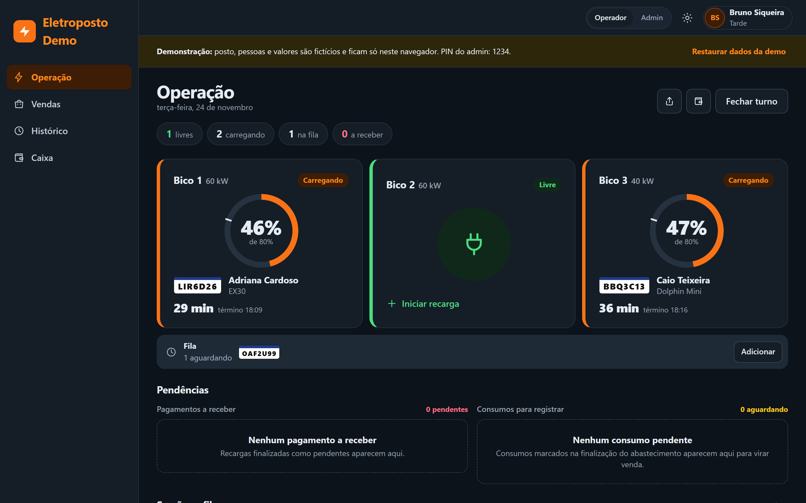
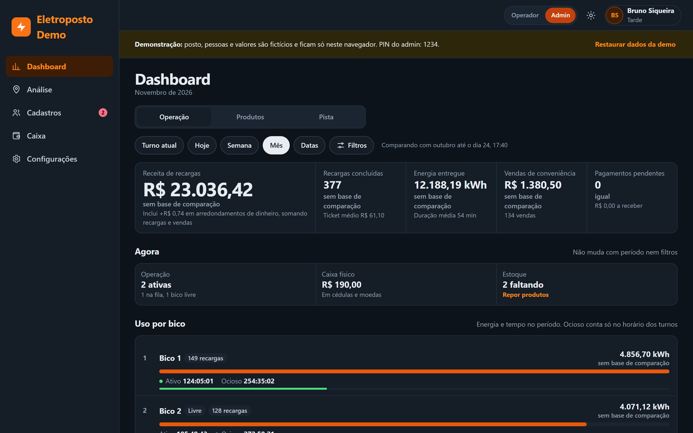
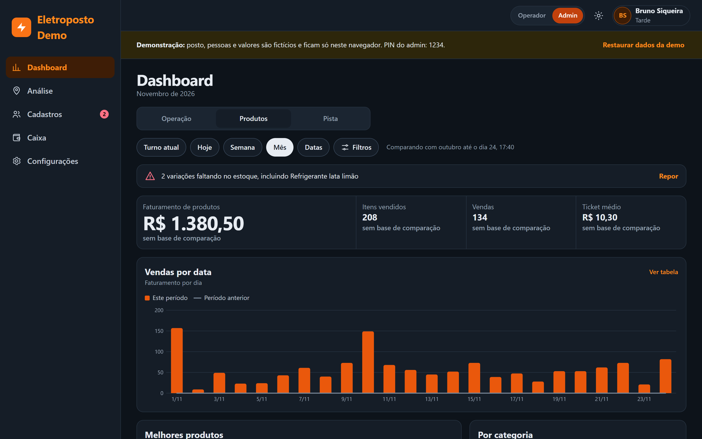
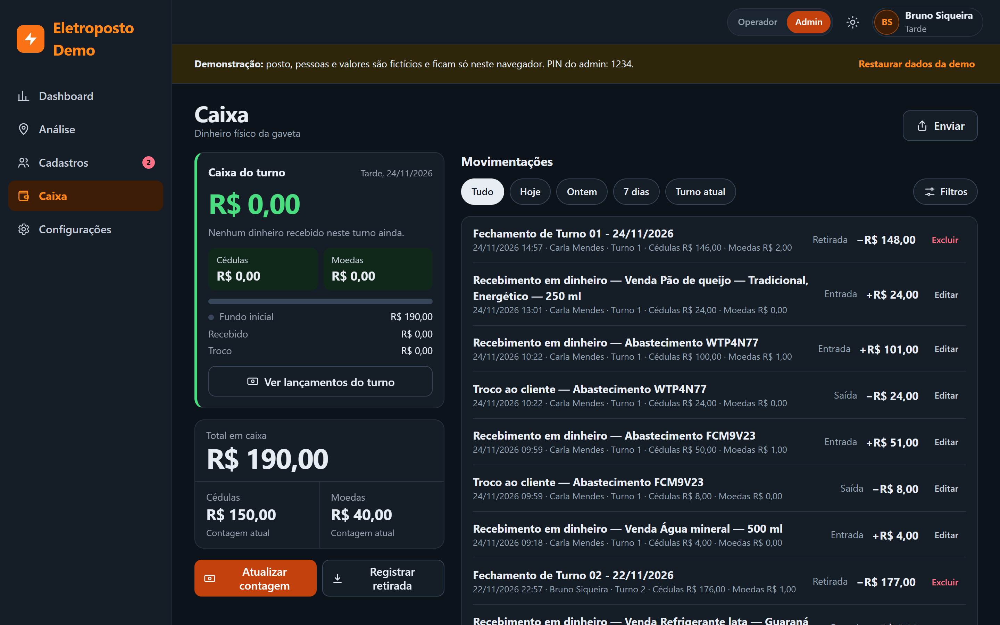
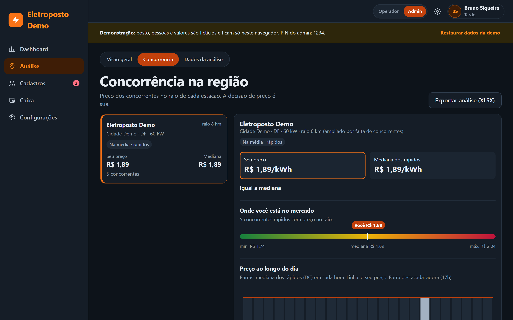
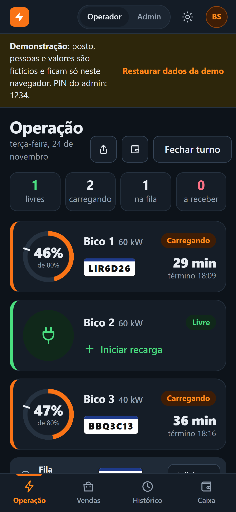

# Eletroposto · gestão de posto de recarga de veículos elétricos

[](https://github.com/2402thiago/eletroposto-gestao/actions/workflows/quality.yml)

App web (PWA) para operar um posto de recarga de carros elétricos: recargas nos bicos, fila, vendas da conveniência, estoque, caixa por turno e relatórios.

**Demo:** [eletroposto-gestao.vercel.app/?demo](https://eletroposto-gestao.vercel.app/?demo). Abre direto num posto fictício com 30 dias de dados. Não precisa de login.



## O problema

O posto controlava as recargas e as vendas pelo WhatsApp e não fazia fechamento de caixa. No fim do dia não havia como saber quanto cada bico rendeu, quanto entrou em dinheiro em cada turno nem o que faltava no estoque da conveniência.

## A solução

Um app que roda no celular do operador e no computador do administrador:

- O **operador** inicia e finaliza recargas, registra vendas e fecha o turno com a contagem do caixa.
- O **administrador** acompanha faturamento, energia entregue, uso de cada bico, estoque e preço da concorrência.

**Em produção:** a versão de produção roda num posto de recarga desde agosto de 2026 e já registrou 1.568 recargas e 455 vendas. Um segundo posto está em fase inicial de testes.

> **Este repositório é a versão de demonstração, sem backend.** Os dados ficam só no navegador (`localStorage`). A versão de produção também sincroniza os aparelhos do posto com o Google Sheets, por um Apps Script, e essa parte não está aqui.

## Telas

| Dashboard do administrador | Produtos e estoque |
|---|---|
|  |  |
| **Caixa e fechamento de turno** | **Concorrência na região** |
|  |  |

<p align="center"></p>

## Funcionalidades

- **Operação:** bicos com potência própria (ex.: 60 kW e 40 kW), recarga em andamento com tempo restante e término previsto, fila de espera e cadastro rápido de placa nova.
- **Pagamentos:** Pix, crédito, débito, dinheiro e pagamento dividido. Em dinheiro, o app calcula o troco em cédulas e moedas e aceita troco por Pix.
- **Pendências:** recarga ou consumo "a receber" fica registrado até ser pago. Venda pendente **reserva** o estoque em vez de dar baixa.
- **Conveniência e estoque:** produtos com variações, combos, estoque mínimo e ideal, sugestão de compra, reposição e itens de uso interno.
- **Caixa por turno:** turnos configuráveis, livro de movimentos (entrada, troco, retirada), card "Caixa do turno" e fechamento de turno. O operador corrige um lançamento com o PIN do administrador.
- **Dashboard:** receita, recargas, energia, ticket médio e uso de cada bico por turno, dia, semana ou mês, com comparação ao período anterior.
- **Análise:** saúde financeira do mês (energia, custos fixos e resultado), clientes que mais carregam e preço contra a concorrência no mapa. Exporta em XLSX.
- **Relatórios pelo WhatsApp:** status do posto, fechamento de turno e lista de compras do estoque.
- **PWA:** instala no celular e funciona sem internet (service worker).
- **Backup:** exporta e restaura todos os dados em JSON.

## Modo demonstração

- O link com `?demo` (ou o botão **Entrar como demonstração** na primeira abertura) cria um posto fictício: 3 bicos (60, 60 e 40 kW), 2 turnos, 4 operadores, cerca de 470 recargas, vendas da conveniência, 20 produtos (alguns abaixo do mínimo) e fechamentos de caixa.
- As datas são geradas a partir do momento em que a página abre, então a demo sempre mostra os últimos 30 dias.
- Uma faixa no topo avisa que os dados são fictícios, e o botão **Restaurar dados da demo** desfaz qualquer alteração.
- No topo, o seletor **Operador | Admin** troca de perfil. O PIN do administrador na demo é **1234**.

## Tecnologias

- JavaScript puro (sem framework), HTML e CSS
- PWA com service worker e `localStorage`
- [Vitest](https://vitest.dev/) e jsdom para os testes, ESLint e Prettier
- GitHub Actions: testes, lint, formatação e `npm audit` a cada push
- Vercel para a hospedagem, com cabeçalhos de segurança (CSP) em `vercel.json`
- Leaflet e OpenStreetMap no mapa da concorrência

## Rodar localmente

Requer Node.js 22 ou mais recente.

```bash
npm install
npm run build
npx serve public        # ou: python -m http.server 8080 --directory public
```

Abra o endereço mostrado e acrescente `?demo` para carregar os dados de demonstração.

## Testes

```bash
npm test            # Vitest
npm run lint        # ESLint
npm run check       # build + lint + testes (o mesmo do CI)
```

## Estrutura

- `index.html`: estrutura da página.
- `src/core.js`: regras puras (turnos, caixa, estoque, formatação e XLSX), sem DOM.
- `src/app.js`: interface, eventos e gravação no `localStorage`.
- `src/demo.js`: gerador dos dados de demonstração.
- `src/analise/`: aba Análise (módulos ES).
- `src/sw.js`: service worker.
- `test/`: testes de unidade e de interface (jsdom).

## Como foi desenvolvido

O código deste projeto foi escrito com IA generativa (Claude, da Anthropic). O meu papel foi:

- levantar os requisitos com o posto;
- definir as regras de negócio (turnos, troco, fechamento de caixa, reserva de estoque, pendências);
- testar e validar cada versão na operação real antes de liberar.

A versão de produção passou por 89 versões e tem 228 testes automatizados. Esta versão de demonstração reúne as funcionalidades que rodam só no navegador e tem a própria suíte de testes, que roda no GitHub Actions.

## Licença

Todos os direitos reservados. O código está público para avaliação; veja [LICENSE](LICENSE).
